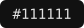
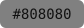
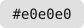
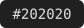

# vity-monkeytype

[vity](https://github.com/Alexdelia/vity-base24) theme for [monkeytype](https://monkeytype.com).

<table id="palette">
<tr>
<td>background</td>
<td><code>#111111</code></td>
<td></td>
<td>main</td>
<td><code>#a020f0</code></td>
<td></td>
</tr>
<tr>
<td>sub</td>
<td><code>#808080</code></td>
<td></td>
<td>text</td>
<td><code>#e0e0e0</code></td>
<td></td>
</tr>
<tr>
<td>caret</td>
<td><code>#ffd1ff</code></td>
<td></td>
<td>sub alt</td>
<td><code>#202020</code></td>
<td></td>
</tr>
<tr>
<td>error</td>
<td><code>#d32f2f</code></td>
<td></td>
<td>extra error</td>
<td><code>#960707</code></td>
<td></td>
</tr>
<tr>
<td>colorful error</td>
<td><code>#ff0000</code></td>
<td></td>
<td>colorful extra error</td>
<td><code>#d32f2f</code></td>
<td></td>
</tr>
</table>

## install

[open in monkeytype](https://monkeytype.com?customTheme=eyJjIjpbIiMxMTExMTEiLCIjYTAyMGYwIiwiI2ZmZDFmZiIsIiM4MDgwODAiLCIjMjAyMDIwIiwiI2UwZTBlMCIsIiNkMzJmMmYiLCIjOTYwNzA3IiwiI2ZmMDAwMCIsIiNkMzJmMmYiXX0%3D) to apply as custom theme, or copy:

```
https://monkeytype.com?customTheme=eyJjIjpbIiMxMTExMTEiLCIjYTAyMGYwIiwiI2ZmZDFmZiIsIiM4MDgwODAiLCIjMjAyMDIwIiwiI2UwZTBlMCIsIiNkMzJmMmYiLCIjOTYwNzA3IiwiI2ZmMDAwMCIsIiNkMzJmMmYiXX0%3D
```

or print it:

```sh
nix run github:Alexdelia/vity-monkeytype
```

## any base16 / base24 scheme

```sh
nix run github:Alexdelia/vity-monkeytype#generate -- path/to/scheme.yaml
nix run github:Alexdelia/vity-monkeytype#generate -- --palette palette path/to/scheme.yaml > table.html
```

without nix, `yq` ([yq-go](https://github.com/mikefarah/yq)) and `jq` `>= 1.7` on `PATH`:

```sh
./generate.sh [--palette <dir>] path/to/scheme.yaml
```

base24 slot -> monkeytype color mapping: [`generate.sh`](generate.sh). base16 schemes: `colorfulError` falls back to `base08`.

## freshness

- link, palette table and `palette/` swatches generated from `vity.yaml` pinned in `flake.lock`
- `generated` git hook rewrites them on every commit (`nix run .#update-generated`)
- `nix flake check` fails when either differs from generated one, run on every push by [check workflow](.github/workflows/check.yml)
- after vity change: `nix flake update vity-base24`, then commit

## development

```sh
direnv allow
```

or `nix develop`. Both install git hooks (formatting, lint, typos, generated files).
